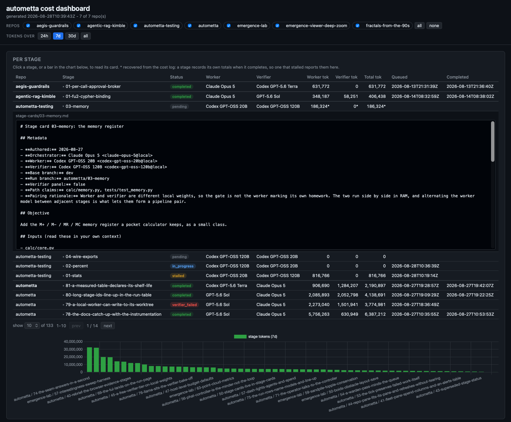
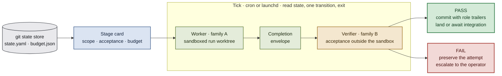

# Autometta

**Token-maxing is the gateway drug to AI psychosis. Autometta is a lightweight YOLO pattern library for headless agent orchestration on a single machine without constant human oversight. Worker agents code against requirement cards, verified by cross-family agents: Codex verifies Claude, and vice versa.**

   

Autometta turns requirement cards into implemented, independently checked commits. It runs Claude Code and Codex CLI as worker and verifier pairs on one laptop. A cron-driven tick handles dispatch, budgets and recovery. The human writes the cards and takes the decisions the contract cannot.

The interesting engineering problem is not getting an agent to write code. It is what happens after the agent says it is done. Autometta separates implementation from acceptance, keeps failed attempts, and records who wrote, who checked and who integrated every change. You read the brief, the checks and the commit, not a chat summary.

[How it works](#how-it-works) · [The bets](#the-bets) · [How it got here](#how-it-got-here) · [What it taught us](#what-it-taught-us) · [Evidence and limits](#evidence-and-limits) · [Get started](#get-started) · [Documentation](#documentation)



*An earlier fleet run. The current dashboard adds repository selection, stage-card click-through and separate views of per-role usage and the shared subscription allowance. See the [dashboard guide](docs/dashboard.md).*

## Why bother

Faster code generation does not shrink the work. It moves it to specifying, checking and integrating. Autometta makes those three jobs explicit before anything is dispatched.

- **Define done first.** Each card names its deliverables, constraints, acceptance criteria, worker and verifier. The acceptance test can be frozen with a digest, so the worker cannot rewrite the test to fit its output.
- **Separate delivery from approval.** The worker's completion envelope triggers verification. A verifier from the other model family runs the criteria outside the worker's sandbox. A worker cannot approve its own change.
- **Bound the autonomy.** Budget files, quota admission and liveness checks decide when the loop stops. Failed work is kept for inspection. Anything the tick cannot decide becomes an escalation for a human.
- **Leave a trail.** Stage cards, frozen assertions, verifier artefacts and role-attributed commit trailers connect intent to code. Cost logs and first-attempt rates show where the process wastes effort.

If you run engineering teams, this is what delegated AI delivery looks like when it has to stop on its own and explain itself afterwards. If you are an engineer, it is bash, Markdown, JSON, YAML and git, with no hosted orchestration dependency.

## How it works



The card is the brief for both roles. The worker implements inside its declared permissions and returns a structured envelope. The verifier checks the tree against the card and its frozen assertions. The orchestrator owns the commit and the decision to integrate.

The automated layer is a short-lived tick run by macOS launchd or Linux cron. It reads state, advances whatever is eligible, records the result and exits. Two adjacent stages may overlap when their declared path claims are disjoint; verification and landing stay ordered. A stage that depends on earlier code waits until that code is on its dispatch base.

A verifier PASS is not the same as integration. If a run branch cannot land cleanly the work waits as `awaiting integration` for the operator. Mechanical recovery is the tick's job. Decisions go to the operator's orchestration chat through lifecycle hooks, with optional idle wake-ups that are batched and rate-limited. There is no scheduled controller agent; that experiment is covered below.

## The bets

Made early, on purpose, and unchanged since.

| Bet | Why, and what it costs |
| --- | --- |
| **Git and files as the state store** | Cards, run branches, state snapshots and commit trailers are readable with ordinary tools. In exchange, file integrity, locking and worktree ownership all need explicit handling. |
| **A contract before a scheduler** | The seven-step dispatch protocol works by hand. The loop automates the same boundaries rather than inventing a second delivery process. |
| **Cross-family verification** | Claude checks Codex, or Codex checks Claude. Authorship and judgement are separated. It is not a guarantee against a bad requirement or an error both models share. |
| **The sandbox is the role boundary** | Codex `workspace-write` limits worker permissions. Worker self-checks do not replace independent acceptance; checks needing wider access require an explicitly equipped verifier seat. |
| **Cron plus tick, not a daemon** | No resident model is paid to poll a queue. Scheduling latency and a laptop that has to stay awake are the price of a single-machine design. |
| **A budget file, not retries** | The loop halts or escalates rather than backing off. Caps are enforced per dispatched process, so one dispatch of overshoot is the floor. |
| **Explicit billing routes** | Subscription, metered API and free local routes are chosen per repo. Every dispatch sanitises inherited credentials, so a stray key cannot silently move you to API billing. |

The [dispatch contract](docs/dispatch-contract.md), [tick-loop design](docs/tick-loop.md) and [lessons](docs/lessons.md) carry the reasoning and the failure modes behind each row.

## How it got here

Autometta did not start from a blank page. It packages two earlier projects: a dispatch contract from a fractal-rendering side project (the stage card, the acceptance command, the headless gotchas) and the cron tick, budget file and cross-family verification protocol from an agentic RAG build. Steve Yegge's Gas Town supplied three patterns taken verbatim (git-backed ledger, persistent agent identity, stall detection as a first-class state); Aider's architect/coder split supplied the role taxonomy.

The release history records how the contract grew:

| Date | Autometta |
| --- | --- |
| 2026-05 | v0.1.0: dispatch contract, tick loop and unattended launchd path |
| 2026-08 | v0.2.0: TUI, pipeline pairs, stale-build warning and verifier bake-off |
| 2026-09 | v1.0.0: typed fact ledger, guarded SDK verifier route, frozen card assertions and network preflight |
| 2026-10 | v1.1.0: model-scoped reserve, live agent progress, stage dependency graph and Codex admission below full usage |

Since the tag: the scheduled controller agent is retired, lifecycle notices and bounded native wake-ups replace it, and card-quality tooling (card lint, first-attempt rate, card-review and oracle skills) followed.

Three experiments closed against adoption on the way. A resident SDK controller lost to cron plus tick: the SDK session could not create its own session directory inside the sandbox, and a resident process gives up restartability and outside observation for nothing. A worker SDK route was tried and parked: it could not reach its first tool call without widening the very scope the sandbox exists to hold. A terminal multiplexer was retired once the SDK transport covered what it was probing. The postmortems are under `docs/experiments/`. The SDK survives in one seat, the verifier, with a route guard: the raw Claude API SDK returns 429 on a subscription token while `claude -p` answers on the same one, so that pairing is sent back to the CLI (see [SDK verifiers](docs/sdk-verifier.md)). The bets did not change; the passes since v0.1 have been about making the loop remember what it learnt and refuse to lie about what it checked.

## What it taught us

The [lessons](docs/lessons.md) file records twenty-two headless gotchas, each with the incident, the failure mode and the fix. The ones worth knowing before your first overnight run:

- **The only safety failed silently while everything looked green.** The budget cap was checked once per tick, not at the point of spend. One repo burned 149 times its token cap in a day, every stage passed, the work was good, and the daily reset zeroed the evidence by morning. The cap now guards the spawn and a breach log survives the reset. A safety belongs at the action it guards, not at the top of the loop that eventually performs it.
- **A worker can die at 21 seconds and leave a zero-byte log.** A Claude worker in a subshell got SIGHUP when the launchd tick exited. Codex, with no subshell, was fine. Fix is `disown` plus `AbandonProcessGroup`, and the heartbeat now treats a silent log as a stall.
- **A missing space killed every verifier.** `IFS` without a space turned an intended word split into a no-op, so `--effort high` reached the CLI as one option name and burned all three retries per card. Multi-token arguments travel in arrays.
- **A tick can destroy its own state.** `state.yaml` was gitignored, the backup `git add` was a silent no-op, and a degenerate write could replace the only copy with an empty stub. The tick now keeps a rolling backup and snapshots state through a throwaway index.
- **A sandbox pass can be a lie.** A worker that appears to pass acceptance inside `workspace-write` may be reporting side-effects it could not perform. That accident became the role boundary rather than a bug to patch.
- **A criterion the verifier cannot satisfy fails exactly like broken code.** The case study's one rejection came from a card that asked for something the verifier's seat could not check. Card review now includes a seat check before anything is queued.

## Evidence and limits

One operator runs this daily across several repositories. The latest tag is v1.1.0, dated 2026-10-09. The tag means the contract, loop and operator surfaces are stable. It does not mean teams or production.

| Evidence | What it shows |
| --- | --- |
| [Self-host stage cards](stage-cards/) and `Autometta-*` commit trailers | The loop built this repo with itself. Worked briefs, acceptance checks and role provenance for every landed stage. |
| [Logistic Mandelbrot case study](docs/case-study-logistic-mandelbrot.md) | One creative brief became a five-stage product build in about 4.5 hours, including a 50-minute model outage. The verifier rejected one faulty requirement; human visual polish and release followed. |
| [BENCH-005 lane reports](examples/benchmarks/bench-005/) | A formal external Swift refactor benchmark. Both lanes exhausted their bounded attempts with acceptance still failing. Failure evidence, not a productivity claim. |
| [Lessons](docs/lessons.md) and [contract smokes](#development) | Reproducible checks for lost state, broken argument handling, silent agent death and the budget overrun. |
| [Verifier bake-off](docs/verifier-bake-off.md) | Eight free-tier candidates graded against ten benchmark stages. No free candidate exceeded 77% FAIL recall, so the free tier handles mechanical checks only. Dated, not a current model recommendation. |

The case study shows the workflow working. It does not establish a speed-up or a return on investment. There is no green result from the external benchmark yet.

Scope is **one human, one machine**. macOS is the reference platform with Linux via cron. No native Windows; WSL2 is untested. No team coordination, no SLA. The host has to be awake.

Provider behaviour has a shelf life. Local-model compatibility, SDK routes, prices and quota readings all depend on installed versions and account state. The [setup guide](docs/setup.md) carries the preflights; [measurement shelf life](docs/measurement-shelf-life.md) explains how dated findings are kept honest. Codex chat delivery of wake-ups has been exercised; live Claude idle resumption has not.

## Get started

Use Autometta when the task has a clear acceptance condition and splits into bounded stages. Exploratory work with no definition of done belongs in a normal interactive session first.

**Try the contract by hand.** Read the [seven-step protocol](docs/dispatch-contract.md#the-seven-steps), fill in the [stage-card template](templates/stage-card.md) and walk the [orchestrator checklist](templates/orchestrator-checklist.md). Dispatch one worker, run acceptance outside its sandbox, then have a verifier from the other family inspect the result before you commit. Either family can orchestrate. No `scripts/`, no cron.

**Automate a queue.** The loop needs Bash 3.2+, Git, Python 3, `jq`, `yq`, both vendor CLIs, `agent-whoami`, `op-fetch` and the 1Password CLI. The helper scripts and credentials do not arrive with this clone. Homebrew is needed for the local installer; tmux is optional. Check the [dependency inventory](docs/machine-dependencies.md) first.

From this checkout on macOS:

```sh
scripts/install-homebrew-local.sh
autometta check-deps
autometta init /path/to/target-repo
git -C /path/to/target-repo status --short
```

`init` creates local configuration and state, registers the repo and installs its LaunchAgent. Review the generated files, tracking policy, auth and budget before queueing anything. Do not force-add ignored runtime state or the local manifest. The [runbook](docs/runbook.md) covers card review, queueing and scheduling; [setup](docs/setup.md) covers the Linux cron path.

Check the billing route for each family before dispatching:

```sh
autometta auth status
autometta auth check codex
autometta auth check claude
```

Watch a run:

```sh
autometta status
autometta graph --repo /path/to/target-repo
autometta tui /path/to/target-repo
autometta dashboard --open
```

After updating this checkout, rerun `scripts/install-homebrew-local.sh`, then `autometta --version` and `autometta check-build`. Pulling source or `brew update` alone does not refresh the installed toolchain. See [deployment](docs/deployment.md) for subscriber refresh and build provenance.

## Documentation

| You want to | Start here |
| --- | --- |
| Assess the design | [Philosophy](docs/philosophy.md), [dispatch contract](docs/dispatch-contract.md), [tick loop](docs/tick-loop.md) |
| Inspect the evidence | [Case study](docs/case-study-logistic-mandelbrot.md), [stage cards](stage-cards/), [benchmark reports](examples/benchmarks/bench-005/), [lessons](docs/lessons.md) |
| Adopt and operate it | [Runbook](docs/runbook.md), [setup](docs/setup.md), [command manual](MANUAL.md), [deployment](docs/deployment.md) |
| Understand acceptance and ordering | [Verification](docs/verification.md), [worker envelope](docs/dispatch-envelope.md), [dependency graph](docs/dependency-graph.md) |
| Watch health and spend | [Observability](docs/observability.md), [dashboard](docs/dashboard.md), [cost log](docs/cost-log.md), [budget drains](docs/budget.md) |
| Extend verification or shared memory | [SDK verifiers](docs/sdk-verifier.md), [verifier panel](docs/verifier-panel.md), [fact ledger](docs/fact-ledger.md), [graph engineering](docs/graph-engineering.md) |

`docs/design/`, `docs/proposals/`, `docs/experiments/` and the dated incident records keep the reasoning and the results. A proposal is not evidence that a feature shipped. The vendor comparisons in [prior art](docs/prior-art.md) are context, not buying advice.

## Development

There is no application build or package manifest. The product is the contract, the templates, the agent skills and the shell and Python scaffolding under `scripts/`, exposed through `bin/autometta`. The contract tests are `scripts/*-smoke.sh`; a few provider integration checks need credentials or a configured host.

Start with the frozen-contract gate, then the offline smokes relevant to the change. For card preparation:

```sh
scripts/check-contract-test-gate.sh --worktree
scripts/card-template-fields-smoke.sh
scripts/card-lint-smoke.sh
```

Frozen assertions and their card digests stay together. A passing targeted smoke is evidence for that surface, not a claim that every provider route or historic stage has been re-run. Claude Code and Codex CLI share the same [agent brief](AGENTS.md) and the in-repo [memory contract](memory/README.md).

## Security and publication

Credentials and machine settings live in ignored local files or the secret manager. Runtime records stay local. Stage cards, templates and tests are public review material; private session handoffs and run records are kept off the curated public head.

Publication goes through a guarded PR with a leak audit over the incoming history as well as the final tree. A human reviews and merges. See [billing setup](docs/setup.md#7-auth-routes-subscription-api-key-and-free) and the [publish workflow](docs/PUBLISH-WORKFLOW.md).

## Licence

MIT. See [LICENSE](LICENSE).
